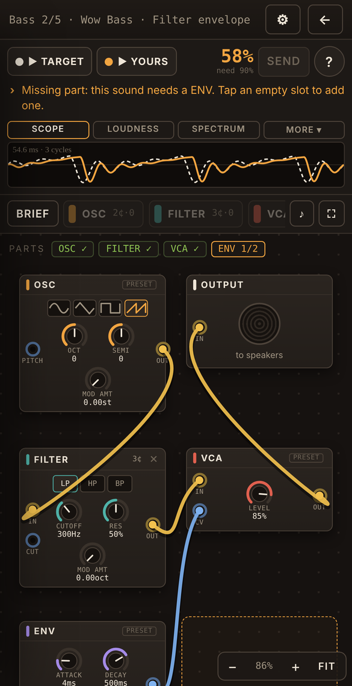

# Synth Patch Hero

<p align="center"><a href="https://swarkentin.github.io/synth-patch-hero/"><b>▶&nbsp;&nbsp;PLAY NOW: swarkentin.github.io/synth-patch-hero</b></a><br><sub>Runs in your browser on desktop or phone. Headphones recommended.</sub></p>

**A puzzle game about building synth patches.** You're a broke musician taking gigs from artists who want very specific sounds. Each gig hands you a reference sound and a rack. Patch oscillators, filters, envelopes and LFOs together until your sound matches theirs. Every gig teaches one new piece of synthesis.


<p align="center"></p>

## Play

- **Online:** **https://swarkentin.github.io/synth-patch-hero/**, deployed from `main` by [`.github/workflows/pages.yml`](.github/workflows/pages.yml) whenever the tests pass.
- **Locally:** `npm start`, then open http://localhost:8080. Opening `index.html` directly also works.

There's no build step and there are no dependencies: it's plain HTML, CSS and JavaScript using the Web Audio API. Use headphones.

## How it plays

1. **Pick a gig.** Read the client's brief and the manual page for that lesson.
2. **Fill the board.** OUTPUT sits in the top-right slot, and some gigs start with **preset** modules already wired. Tap an empty slot (or a palette button) to add a module. The **Parts** chips (`FILTER 0/1`) tell you what's still missing.
3. **Patch.** Drag from jack to jack, or tap one jack and then another. Yellow cables carry audio, blue cables carry control signals. Click a cable to unplug it.
4. **Tune.** Drag knobs up and down (Shift for fine control), or **click a knob** for a precise editor with fine −/+ steps and arrow keys.
5. **Compare.** ▶ Target vs ▶ Yours, plus an oscilloscope, loudness and spectrum overlays and hints, are always on screen. Press **⛶ Focus** (or Shift+F) for a full-screen board with a compact compare bar.
6. **Stuck?** Press **Help**. It first points out missing modules or cables (and can patch them for you), then names the knob that matters most and explains it. Press again and it can **lock** that knob at the client's value. Tap a locked knob to see why, or to unlock it.
7. **Send** at a 90% match or better. Your patch plays a short **jingle** to celebrate. Then come back and beat par on cost.

On phones, knobs, cables and modules give **haptic feedback** (Android fully; iPhone on iOS 18+). Switch it off from the gig board.

**Keyboards:** open **♪ Keys** for an on-screen keyboard that shows the client's note to find. USB/MIDI keyboards work in Chrome, Edge, Opera and Firefox on desktop, and Chrome on Android (velocity and sustain pedal included). Computer keys `A`–`K` play too, `Z`/`X` shift the octave, `Space` plays yours and `Shift+T` plays the target. The board zooms with `+` `-` `0`, Ctrl+scroll or pinch.

## Curriculum

**Basics** is a seven-lesson tutorial on the building blocks, followed by six **themes**. **Every gig is open**, so start with Basics or skip ahead; your progress is saved either way, and each chapter marks its next gig. Each theme teaches its style through several lessons and ends with a **challenge**: no parts list, just the brief, the sound and how many modules the patch uses.

| Chapter | Gigs (★ = challenge) |
|---|---|
| **Basics** | Dial Tone (oscillator, pitch, cables) · Shape of Sound (waveforms) · Pixel Knight (intervals) · Thin Walls (low-pass) · Curtain Call (VCA + envelope) · Pluck (attack & decay) · Vibrato (LFO, modulation) |
| **Filter Lab** | Squelch (resonance) · Payphone (filter types) · Thin Air (high-pass) · Talk Box (formants) · ★ Acid Test |
| **Bass** | Sub Club (sub bass) · Wow Bass (filter envelope) · Pluck Bass · Wobble (LFO → filter) · ★ Reese |
| **Pads** | Slow Bloom (pad envelopes) · Glass Pad (layering) · Breathing Pad (slow LFO) · ★ String Section |
| **Leads** | Brass Stab (filter attack) · Neon Avenue (detune) · Night Flute (expressive lead) · ★ Stadium Lead |
| **Percussion** | Kick It (pitch envelope) · Floor Tom (tuning drums) · Snare Crack (noise) · Hi-Hat (short envelopes) · ★ Cowbell |
| **Sound FX** | Laser Zap (pitch sweeps) · Siren (square LFO) · Wind (filtered noise) · ★ Close Encounter |

Plus **Free Jam**, a sandbox with everything unlocked.

## How matching works

The target and your patch are both rendered offline (`OfflineAudioContext`, 22.05 kHz) and compared on three measures:

- **Spectrogram (50%):** timbre over time, on 1/36-octave bands, with each frame normalized and weighted by loudness.
- **Tone (20%):** the time-averaged spectrum shape.
- **Shape (30%):** the loudness envelope on a perceptual scale.

Each distance becomes a score with `exp(-d/K)`, and the scores are combined with a weighted geometric mean. Gigs built on movement (vibrato, wobble, detune) get a wider tolerance. Because matching listens to the audio, any patch that sounds right passes, not just the reference patch. Hints (pitch in semitones, brighter/darker, attack, length, missing parts) come from pitch detection, spectral centroid and envelope features.

## Project layout

```
index.html          markup only
css/style.css       all styles (desktop, tablet, phone breakpoints)
js/data.js          module types and the gig list (briefs, manual pages, target patches, presets)
js/store.js         saved progress (localStorage) and patch helpers
js/audio.js         Web Audio engine: patch → voice, live playback, end-of-gig jingles
js/analysis.js      offline render, FFT, match score, hints
js/ui-core.js       shared UI state and helpers
js/haptics.js       vibration / iOS switch-haptic feedback
js/keys.js          on-screen keyboard, computer keys, Web MIDI, play-the-note prompt
js/ui.js            gig board, slot board, zoom/pan, knobs, cables, compare panel
js/help.js          Help ladder: wiring hints, key-knob hints, knob locking, stuck detection
js/selftest.js      scoring calibration run (index.html#selftest)
tests/              headless-Chrome tests (npm test)
scripts/            dev server, screenshot generator
docs/design.md      design notes and decisions
```

## Development

```sh
npm start              # http://localhost:8080
npm test               # scoring calibration + every gig opens on desktop & phone + every gig is solvable
npm run screenshots    # regenerate docs/screenshots/
```

Tests need Node 22+ and Chrome or Chromium on the PATH (or set `CHROME_PATH`). CI runs them on every push and pull request.

**Adding a gig:** add an entry to `LEVELS` in `js/data.js` with a chapter (`ch`), a brief, a manual page, a palette, and a `target` patch (plus optional `start` presets, `startCables`, `challenge`, `tol`/`tolShape`). Gigs appear in their chapter in the order they're listed. `npm test` checks that it fits the board, that its reference patch scores 100%, and that an untouched rack doesn't pass. If you change the scoring, keep the bands in `tests/run.mjs` passing, or update them on purpose.

See [`docs/design.md`](docs/design.md) for the design decisions behind the layout, slot board, scoring and touch controls.

## License

[MIT](LICENSE)
